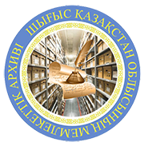
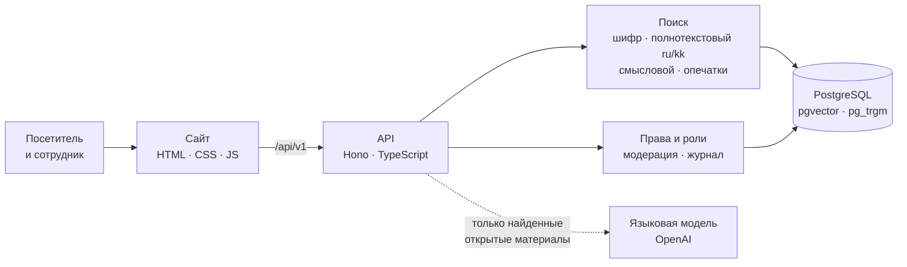
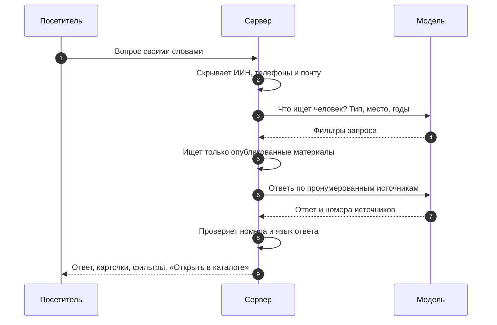

<div align="center">



# Государственный архив ВКО

**Цифровой читальный зал Государственного архива Восточно-Казахстанской области и его филиалов**

Спросите своими словами — архив ответит документом, фотографией и адресом филиала.

<br>

[](https://e-arhiv-vko.vercel.app/)
[](docs/JURY_GUIDE.md)

[](https://github.com/temirkhanerbolatovich-coder/e-arhiv-vko-research/actions/workflows/backend.yml)


[Возможности](#-попробуйте-за-минуту) · [Отличия](#-чем-мы-отличаемся) · [Как устроено](#-как-устроено) · [Запуск](#-запуск-за-две-команды) · [Документация](docs/README.md) · [ТЗ](docs/requirements/README.md)

</div>

<br>

> «Сегодня, чтобы найти документ в архиве, нужно знать, что такое фонд, опись и дело.
> Наш читальный зал этого не требует: вы спрашиваете своими словами, а архив отвечает документом.»

Это **информационный** сайт: каталог, история региона, выставки, филиалы и справочные сведения. Заявления, заказы и платежи сайт не принимает. По услугам он даёт справку и ссылку на официальный ресурс (eGov, ЦОН), а обратную связь о сайте собирает гостевая книга.

> [!NOTE]
> Рабочий прототип для **Codemasters Hackathon 9.0**. Защита — **13 ноября 2026 года**.
> Концепция, модель данных и оформление — предложения команды, заказчиком пока не утверждены.

<br>

## ⌕ Попробуйте за минуту

| | Что сделать | Что увидите |
|:---:|---|---|
| **1** | [Открыть помощника с вопросом «Покажи фото Усть-Каменогорска 1960-х»](https://e-arhiv-vko.vercel.app/#/chat?question=%D0%9F%D0%BE%D0%BA%D0%B0%D0%B6%D0%B8%20%D1%84%D0%BE%D1%82%D0%BE%20%D0%A3%D1%81%D1%82%D1%8C-%D0%9A%D0%B0%D0%BC%D0%B5%D0%BD%D0%BE%D0%B3%D0%BE%D1%80%D1%81%D0%BA%D0%B0%201960-%D1%85) и нажать <kbd>→</kbd> | Ответ помощника с карточками-источниками, применёнными фильтрами `Фото · Усть-Каменогорск · 1960–1969` и кнопкой «Открыть в каталоге» |
| **2** | [Спросить о Лениногорском комбинате](https://e-arhiv-vko.vercel.app/#/chat?question=%D0%93%D0%B4%D0%B5%20%D0%B4%D0%BE%D0%BA%D1%83%D0%BC%D0%B5%D0%BD%D1%82%D1%8B%20%D0%9B%D0%B5%D0%BD%D0%B8%D0%BD%D0%BE%D0%B3%D0%BE%D1%80%D1%81%D0%BA%D0%BE%D0%B3%D0%BE%20%D0%BF%D0%BE%D0%BB%D0%B8%D0%BC%D0%B5%D1%82%D0%B0%D0%BB%D0%BB%D0%B8%D1%87%D0%B5%D1%81%D0%BA%D0%BE%D0%B3%D0%BE%20%D0%BA%D0%BE%D0%BC%D0%B1%D0%B8%D0%BD%D0%B0%D1%82%D0%B0%3F) и нажать <kbd>→</kbd> | Фонды организации и подсказку о прежнем названии: «Лениногорск → Риддер» |
| **3** | [Найти по шифру `Р-136`](https://e-arhiv-vko.vercel.app/#/catalog?q=%D0%A0-136) | Точный шифр выходит первым, затем всё, что совпало по смыслу |
| **4** | Выбрать десятилетие в [«Машине времени»](https://e-arhiv-vko.vercel.app/) | Фотографии архива за выбранные годы, счёт совпадает с каталогом |
| **5** | Нажать <kbd>Сказать</kbd> в поле вопроса, затем <kbd>Прослушать</kbd> у ответа | Вопрос голосом и ответ вслух, средствами браузера |
| **6** | Открыть [«Филиалы и контакты»](https://e-arhiv-vko.vercel.app/#/section/branches) | 14 подразделений на карте, маршрут в 2ГИС и ближайший филиал |
| **7** | Войти в [панель сотрудника](https://e-arhiv-vko.vercel.app/#/admin/login) | Роли, модерация, черновик карточки по скану, импорт, аналитика |

<details>
<summary><b>Демо-учётки панели сотрудника</b></summary>

<br>

Пароль всех учёток: `archive-demo-2026`. По одной учётке на каждую роль из ТЗ 6.1.

| Почта | Роль |
|---|---|
| `admin@archive.demo` | Главный администратор |
| `site@archive.demo` | Администратор сайта |
| `editor@archive.demo` | Редактор контента |
| `archivist@archive.demo` | Архивист, оператор каталога |
| `ridder@archive.demo` | Администратор филиала (только Риддер) |
| `moderator@archive.demo` | Модератор |
| `analyst@archive.demo` | Аналитик |

</details>

<br>

## ✦ Чем мы отличаемся

<table>
<tr>
<td width="33%" valign="top">

**Помощник, которого можно проверить**

ИИ не придумывает ответ: сервер сначала ищет опубликованные материалы, модель отвечает только по ним, а сервер сверяет ссылки на источники. Ответ показывает применённые фильтры и ведёт в каталог.

</td>
<td width="33%" valign="top">

**Исторические названия**

Лениногорск → Риддер, Зыряновск → Алтай, Семипалатинск → Семей, ул. Мира → Головкова, Өскемен ⇄ Усть-Каменогорск. У фондов хранится вся история переименований организаций.

</td>
<td width="33%" valign="top">

**Понятно даже бабушке**

Текст от 17 px, крупные кнопки, кнопка «Аа» до 200 %, тёмная тема. Голосовой ввод и озвучивание ответа. Примеры вопросов вместо пустого поля.

</td>
</tr>
<tr>
<td valign="top">

**Машина времени и памятные даты**

На главной — фото по десятилетиям с 1900-х по 1990-е и ближайшие события из календаря архива. Не нужно ничего формулировать: достаточно выбрать «1950-е».

</td>
<td valign="top">

**ИИ для сотрудника**

Скан документа → черновик карточки (даты, места, лица, ключевые слова) → проверка дублей → модерация → публикация. Аналитика запросов без результата подсказывает, что дополнить.

</td>
<td valign="top">

**Настоящие данные**

Каталог собран из материалов прежнего сайта и файлов заказчика: фонды, газеты, фотографии, страницы, новости и памятные даты. Ничего не выдумано.

</td>
</tr>
</table>

<br>

<div align="center">

| <b>6&nbsp;276</b> | <b>1&nbsp;551</b> | <b>1&nbsp;108</b> | <b>996</b> | <b>14</b> | <b>7</b> | <b>3</b> |
|:---:|:---:|:---:|:---:|:---:|:---:|:---:|
| записей в каталоге | фондов | газет | фотографий | подразделений | ролей сотрудников | языка интерфейса |

</div>

<br>

## ⚙ Как устроено



<details>
<summary><b>Как помощник отвечает на вопрос</b></summary>

<br>



Без модели сайт продолжает работать: помощник переходит в режим обычного поиска.

</details>

| Слой | Технологии | Зачем |
|---|---|---|
| Сайт | HTML, CSS, JavaScript без фреймворка | Быстро открывается и работает даже без сервера на локальных примерах |
| API | Node.js 22, Hono, TypeScript strict | Один небольшой сервер для каталога, помощника и панели сотрудника |
| Данные | PostgreSQL + pgvector + pg_trgm; на демо — PGlite со снимком базы | Те же SQL-запросы в демо и в эксплуатации, старт демо около 4 секунд |
| Помощник | GPT-6 Luna без рассуждений, структурированный JSON | Быстрые ответы; на демо-стенде сейчас GPT-5.1 через Vercel AI Gateway |
| Безопасность | scrypt, подписанная сессия, CSRF, CSP, ограничение попыток входа | Права проверяет сервер на каждом запросе |

<br>

## ▶ Запуск за две команды

Нужны Git и **Node.js 22**. Демо-снимок базы уже лежит в репозитории.

```sh
git clone https://github.com/temirkhanerbolatovich-coder/e-arhiv-vko-research.git
cd e-arhiv-vko-research
```

```sh
npm ci --prefix backend && npm start --prefix backend
```

Откройте **http://127.0.0.1:4173**. Без ключа модели помощник работает как обычный поиск.

<details>
<summary><b>Настройки окружения</b></summary>

<br>

| Переменная | Назначение |
|---|---|
| `OPENAI_API_KEY` | Ключ OpenAI для помощника и распознавания сканов |
| `AI_GATEWAY_API_KEY` | Или ключ Vercel AI Gateway (те же модели OpenAI) |
| `LLM_MODEL` | Модель ответа, по умолчанию `gpt-6-luna` |
| `DATABASE_URL` | PostgreSQL для эксплуатации; без неё — PGlite в памяти |
| `SESSION_SECRET` | Обязателен при `NODE_ENV=production` |

Полный список — в [`backend/.env.example`](backend/.env.example).

</details>

<details>
<summary><b>Проверки</b></summary>

<br>

```sh
npm run check --prefix backend
```

| Что проверяется | Где |
|---|---|
| Типы TypeScript | `tsc --noEmit` |
| Шифры, маскирование ИИН, исторические названия, роли, сессии, модерация, CSV, памятные даты | [`backend/test/domain.test.ts`](backend/test/domain.test.ts) |
| API: каталог, закрытые копии, филиалы, помощник без модели, отзывы, вход, CSRF, права ролей, «Машина времени» | [`backend/test/api.test.ts`](backend/test/api.test.ts) |
| Рабочее место сотрудника, роли, гостевая книга и филиалы в браузере | [`frontend/tests/`](frontend/tests/) |

[GitHub Actions](https://github.com/temirkhanerbolatovich-coder/e-arhiv-vko-research/actions) на каждый push проверяет типы, тесты бэкенда и синтаксис JS сайта. Браузерные тесты запускаются вручную при работающем сервере на `127.0.0.1:4173`.

</details>

<br>

## ▤ Что где лежит

| Папка | Содержимое |
|---|---|
| [`frontend/`](frontend/README.md) | Публичные страницы, панель сотрудника, клиент API, оформление `theme.css` |
| [`backend/`](backend/README.md) | Сервер, поиск, помощник, права, модерация, SQL, снимок базы и тесты |
| [`docs/`](docs/README.md) | ТЗ, концепция, исследования, архитектура, ADR, модель БД и инструкции |
| [`datasets/`](datasets/developer/README.md) | Материалы прежнего сайта и связи с источниками |
| [`reports/`](reports/FINAL_REPORT.md) | Отчёты о составе и ограничениях выгрузки |
| [`tools/docs/`](tools/docs/) | Генерация и проверка модели БД и диаграмм |

<br>

## ↗ Путь разработки

1. **Исследование прежнего сайта** — [состав выгрузки и ограничения](reports/FINAL_REPORT.md).
2. **ТЗ и материалы заказчика** — [требования](docs/requirements/README.md), [карта требований](docs/requirements/traceability.md), [дополнительные документы](docs/data/customer/2026-11-10/README.md).
3. **Концепция и проектирование** — [сценарии](docs/product/concept.md), [анализ архивов Казахстана](docs/research/kz-archives.md), [модель БД](docs/database/README.md), [решения ADR](docs/decisions/README.md).
4. **Сайт и сервер** — [фронтенд](frontend/), [API](backend/src/http/app.ts), [помощник](backend/src/ai/assistant.ts), [тесты](backend/test/).
5. **Публикация** — [e-arhiv-vko.vercel.app](https://e-arhiv-vko.vercel.app/), [порядок обновления](docs/deployment/vercel.md).

Каждый шаг виден в [истории коммитов](https://github.com/temirkhanerbolatovich-coder/e-arhiv-vko-research/commits/main/) и в [CHANGELOG](CHANGELOG.md).

<br>

## ⚑ Честно об ограничениях

> [!IMPORTANT]
> - На демо-стенде база живёт в памяти функции: правки сотрудников и отзывы сбрасываются при перезапуске. Для постоянной работы нужен PostgreSQL (`DATABASE_URL`).
> - Координаты филиалов определены автоматически по адресам и требуют подтверждения архивом.
> - Сведения о фондах взяты из перечня 2018 года; описи и дела представлены выборочно. Записи `demo-*` показывают отдельные состояния интерфейса.
> - Часть редакторов сотрудника работает как подготовка в памяти вкладки, без записи на сервер — см. [локальные сценарии](frontend/LOCAL_STAFF_WORKFLOWS.md).
> - Переводы, актуальность контактов и права на изображения требуют проверки архивом.

<br>

## ⧉ Источники и данные

Исходная площадка — [сайт архива ВКО](http://e-arhiv.vko.gov.kz/ru). Происхождение материалов зафиксировано в [инвентаризации](docs/data/inventory-and-migration.md) и индексах. Полный архив страниц и файлов — в пяти ZIP-частях [релиза исследования v2](https://github.com/temirkhanerbolatovich-coder/e-arhiv-vko-research/releases/tag/archive-2026-11-08-v2), порядок распаковки — в [отчёте](reports/FINAL_REPORT.md).

> [!CAUTION]
> Выгрузки содержат исходные сообщения и контактные сведения прежнего сайта. Публичное происхождение не даёт права повторно публиковать персональные данные. OCR, архивные копии и перечни прошлых лет требуют сверки с оригиналами.

<br>

<div align="center">


<sub>Codemasters Hackathon 9.0 · Усть-Каменогорск · 2026</sub>

</div>
