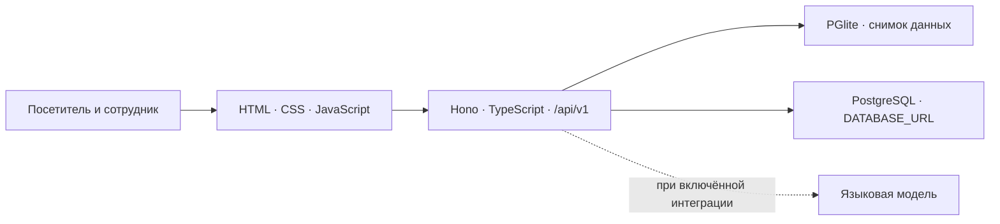

# Государственный архив ВКО

Информационный портал Государственного архива Восточно-Казахстанской области и его филиалов. Поиск архивных материалов, история региона и справочная информация в одном интерфейсе.

[](https://github.com/temirkhanerbolatovich-coder/e-arhiv-vko-research/actions/workflows/backend.yml)
[](https://e-arhiv-vko-portal.vercel.app/)

**[Открыть сайт](https://e-arhiv-vko-portal.vercel.app/)** · **[Маршрут для жюри](docs/JURY_GUIDE.md)** · **[Документация](docs/README.md)** · **[История разработки](https://github.com/temirkhanerbolatovich-coder/e-arhiv-vko-research/commits/main/)**

## Что можно посмотреть

| Возможность | Где проверить |
|---|---|
| Поиск по названию, архивному шифру и фильтрам | [Электронный каталог](https://e-arhiv-vko-portal.vercel.app/#/catalog) |
| Описание, реквизиты и доступность копии | Карточка из результатов каталога |
| Фотографии по десятилетиям и памятные даты | [Главная](https://e-arhiv-vko-portal.vercel.app/) |
| Тематическая экспозиция | [Выставка](https://e-arhiv-vko-portal.vercel.app/#/exhibition) |
| Адреса и контакты 14 подразделений | [Филиалы](https://e-arhiv-vko-portal.vercel.app/#/section/branches) |
| Отзывы, предложения и пожелания | [Гостевая книга](https://e-arhiv-vko-portal.vercel.app/#/section/feedback) |
| Работа сотрудника с учётом роли | [Панель сотрудника](https://e-arhiv-vko-portal.vercel.app/#/admin/login) |

Портал имеет информационное назначение. Сведения об услугах сопровождаются ссылками на официальные внешние ресурсы. Гостевая книга принимает обратную связь о сайте и работе архива.

## Текущая версия

По состоянию на **12 ноября 2026 года** опубликован рабочий прототип с серверным API. Защита проекта назначена на **13 ноября 2026 года**.

- Демо использует снимок с **6 276 ресурсами** и **14 подразделениями**. Числа описывают импортированные записи прототипа.
- Интерфейс предусматривает RU, KK и EN. Часть материалов сохраняет язык оригинала.
- Главный вход по концепции — помощник с переходами к материалам. На текущем стенде он работает в режиме обычного поиска. Код интеграции с моделью включается отдельно через конфигурацию.
- Правки сотрудников и отзывы в демо живут в памяти экземпляра функции. Постоянное хранение требует подготовленного PostgreSQL.
- Полное редактирование публикаций и файлов, полнота переводов, актуальность источников и права на изображения требуют дальнейшей работы.

Статус сценариев и доказательства собраны в [маршруте для жюри](docs/JURY_GUIDE.md).

## Как запустить

Потребуются Git и **Node.js 22**.

```sh
git clone https://github.com/temirkhanerbolatovich-coder/e-arhiv-vko-research.git
cd e-arhiv-vko-research
npm ci --prefix backend
npm start --prefix backend
```

Откройте [локальный сайт](http://127.0.0.1:4173/). Демонстрационный снимок БД уже входит в репозиторий.

Проверки запускаются из корня проекта.

```sh
npm run check --prefix backend
```

Роли и вход в панель описаны в [инструкции сервера](backend/README.md). Настройки перечислены в [образце конфигурации](backend/.env.example), публикация описана в [инструкции Vercel](docs/deployment/vercel.md).

## Как устроен проект



| Папка | Содержимое |
|---|---|
| [frontend/](frontend/README.md) | Публичные страницы, панель сотрудника, клиент API и оформление |
| [backend/](backend/README.md) | Сервер, поиск, права, модерация, SQL, снимок БД и тесты |
| [docs/](docs/README.md) | ТЗ, концепция, исследования, архитектура, модели и инструкции |
| [datasets/](datasets/developer/README.md) | Извлечённые материалы прежнего сайта и связи с источниками |
| [metadata/](metadata/) | Индексы, контрольные суммы и сведения о сборе |
| [reports/](reports/FINAL_REPORT.md) | Отчёты о составе и ограничениях выгрузки |
| [tools/docs/](tools/docs/) | Генерация и проверка БД и диаграмм |

## Полный цикл разработки

1. **Исследование сайта** — [состав выгрузки и ограничения](reports/FINAL_REPORT.md).
2. **ТЗ и материалы заказчика** — [требования](docs/requirements/README.md), [дополнительные документы](docs/data/customer/2026-11-10/README.md), [прейскурант](docs/data/customer/2026-11-11/README.md).
3. **Концепция и проектирование** — [сценарии](docs/product/concept.md), [анализ архивов РК](docs/research/kz-archives.md), [БД и ER-диаграммы](docs/database/README.md).
4. **Фронтенд и интеграция** — [исходники](frontend/), [передача фронтенда](https://github.com/temirkhanerbolatovich-coder/e-arhiv-vko-research/pull/1).
5. **Сервер и проверки** — [API](backend/src/http/app.ts), [тесты](backend/test/), [GitHub Actions](https://github.com/temirkhanerbolatovich-coder/e-arhiv-vko-research/actions).
6. **Публикация** — [сайт на Vercel](https://e-arhiv-vko-portal.vercel.app/), [порядок обновления](docs/deployment/vercel.md).

Общая история сохраняется в коммитах и [CHANGELOG](CHANGELOG.md). Ветка `main` объединяет опубликованный код и документы. `feat/backend` сохраняет этап разработки сервера, `frontend-handoff` — передачу фронтенда, `design/mockup-v1` — ранний дизайн, `verify/vercel-preview-eecb8af6` — проверку автодеплоя.

## Источники

Исходная площадка — [сайт архива ВКО](http://e-arhiv.vko.gov.kz/ru). Происхождение материалов зафиксировано в [инвентаризации](docs/data/inventory-and-migration.md) и индексах. Полный архив страниц и файлов находится в пяти ZIP-частях [релиза исследования v2](https://github.com/temirkhanerbolatovich-coder/e-arhiv-vko-research/releases/tag/archive-2026-11-08-v2). Порядок распаковки указан в [отчёте](reports/FINAL_REPORT.md).

Выгрузки содержат исходные сообщения и контактные сведения прежнего сайта. При работе с ними учитывайте назначение данных, права на публикацию и обработку персональных сведений. OCR, архивные копии и перечни прошлых лет требуют сверки с оригиналами и актуальными данными учреждения.
