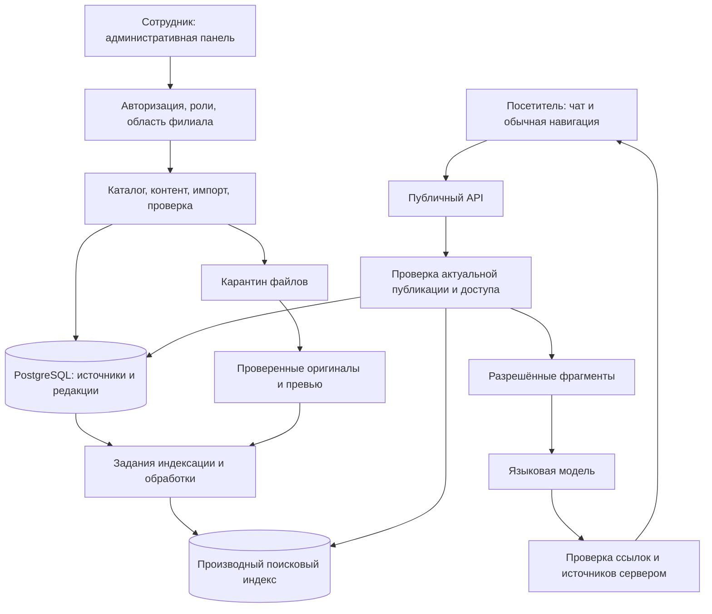

# Архитектура и поток данных

## Реализация прототипа на 12 ноября 2026 года

- `frontend/`: HTML, CSS и JavaScript. Публичный сайт и панель работают с `/api/v1` на том же origin.
- `backend/src/http/app.ts`: маршруты Hono; TypeScript-модули поиска, авторизации и модерации.
- `backend/src/db/schema.sql`: фактическая SQL-схема. Без `DATABASE_URL` используется PGlite и готовый снимок; подключение PostgreSQL предполагает подготовленную БД с данными и расширениями.
- Сотрудники входят через подписанные cookie. Сервер проверяет роли, область филиала и CSRF независимо от состояния меню.
- Модуль помощника включается конфигурацией. На стенде владельца вызовы модели отключены, работает обычный поиск.
- Vercel публикует статику и serverless API. Память функции не обеспечивает постоянное хранение правок.

Инструкции: [сервер](../../backend/README.md), [Vercel](../deployment/vercel.md), [результаты проверок](../testing/verification-2026-11-12.md). Проектная модель на 61 таблицу и схема прототипа различаются по объёму.

## Целевая архитектура первоначального проектирования

Следующие разделы — предложение от 9 ноября. Они описывают целевую систему и не означают, что все перечисленные компоненты реализованы.

Статус: предложение команды. Для начала — один backend с модулями, PostgreSQL, защищённое файловое/объектное хранилище и фоновый обработчик. Микросервисы не требуются. На момент первоначального проектирования frontend/backend фреймворки ещё не были выбраны; текущий стек указан выше.

## Запрос посетителя

1. Сервер ограничивает размер вопроса и частоту запросов; идентифицирует анонимную сессию по защищённому токену, в БД — только хеш токена.
2. Выделяет допустимые фильтры. Значения проверяет сервер; LLM не формирует исполняемый SQL.
3. Точный шифр/название и текстовый поиск объединяются со смысловым поиском. Локализованные маршруты получаются из resource_routes.
4. Перед включением текста в контекст проверяет resource_publications, текущую visibility, доступ к использованному OCR/файлу и принадлежность версии источнику. Проверка повторяется даже если индекс устарел.
5. Модели передаются только нужные разрешённые фрагменты и их непрозрачные ID. Источники — данные, а не инструкции. У модели нет прав менять БД, публиковать или принимать заявки.
6. Сервер принимает ссылки только на возвращённые ID, строит адреса сам, сохраняет message_citations. Проверка ссылки не доказывает истинность всех утверждений — нужны оценка ответов и контрольный набор.
7. При отсутствии источников — честный отказ от фактического ответа и уточнение. При сбое модели — результаты обычного поиска. Ошибки не замалчиваются и не показывают ключи/внутренние трассировки.

## Публикация и снятие доступа

В одной транзакции: решение модератора → опубликованная версия → audit_logs → index_jobs. Фоновый обработчик готовит фрагменты и embeddings идемпотентно. Повтор использует revision/hash/model, а не создаёт дубли. При неудаче — ограниченные повторы с диагностическим кодом.

Отзыв доступа блокирует ресурс на сервере немедленно, даже пока индекс/кэш обновляется. Задание удаления из индекса не является единственной защитой. Файлы выдаются через проверку права или короткоживущие URL; превью проходит ту же политику.

## Анализ качества по ТЗ 5.8 Д

Собирать минимальные обезличенные события и оценки. Группировать запросы без результатов и повторяющиеся проблемы. Модель может предложить дополнить FAQ/переводы/коллекции на основе очищенных агрегатов. Сотрудник проверяет рекомендации; автоматической публикации рекомендаций нет. Полные вопросы и личные сведения не отправляются в аналитику по умолчанию.

## Развёртывание и конфигурация

Раздельные среды dev/test/production; тестовые данные не копируют личные сведения посетителей. Ключ модели, БД и storage поступают из secret/env-конфигурации вне Git. В конфигурации: разрешённый провайдер, модель/размерность, лимиты, таймауты, повторы, сроки хранения, адрес сайта и доверенные внешние URL. Конкретные значения фиксируются перед реализацией.

Наблюдаемость: идентификатор операции, время, модуль, код ошибки, длительность, версия индекса. Не писать в журналы секреты, полный чат, закрытый OCR и лишние персональные данные. Отдельно следить за возрастом очереди индекса и числом неудачных импортов.
