# Проект базы данных v0.1

## Проектная модель и рабочая схема

Эта папка описывает **целевую модель на 61 таблицу**. Для запуска опубликованного прототипа используется другая, сокращённая [SQL-схема](../../backend/src/db/schema.sql) и [клиент БД](../../backend/src/db/client.ts). Данные и сборка снимка описаны в [README сервера](../../backend/README.md).

Без `DATABASE_URL` прототип загружает снимок PGlite; на Vercel изменения существуют в памяти экземпляра функции. Переход к постоянной БД и ограничения демо описаны в [ADR-006](../decisions/README.md). DBML из этой папки не является миграцией действующего сервера.

Статус: **предварительная логическая модель**, уточняется с командой и архивом. Это не развёрнутая БД и не production SQL-миграция. Основания: ТЗ 5–7 и 11, пожелания пользователя о чате, реальные формы выгрузки. Дизайн интерфейса сюда не входит.

## Форматы

- [schema.dbml](schema.dbml) — вся модель для редакторов DBML; 61 таблица с полями, PK/FK и уникальностью. Не нужно загружать приватные данные на сторонний сервис ради просмотра.
- [schema.json](schema.json) — те же сведения для автоматических проверок.
- [Словарь данных](data-dictionary.md) — пояснения всех полей на русском.
- [Ограничения и индексы](constraints.md) — обязательные правила будущей физической реализации, в том числе не выраженные DBML.
- [Генератор](../../tools/docs/build_model.py) — единый редактируемый источник модели; не править три сгенерированных представления независимо.

Число таблиц отражает связи, переводы, версии и аудит всей целевой системы. Оно не является планом писать 61 отдельный сервис или 61 экран. Один backend и одна PostgreSQL достаточны как стартовая архитектура.

## Диаграммы

На схемах отображаются ключи и несколько основных полей. Полный состав — в словаре/DBML. `||` — ровно один, `o|` — ноль или один, `o{` — ноль или много. Линия с именем поля соответствует FK. Подтип имеет общий PK с `resources`; наличие каждого конкретного подтипа у произвольного ресурса необязательно.

| Область | Изображение | Редактируемый исходник |
|---|---|---|
| Каталог и история названий | [SVG](diagrams/01-catalog.svg), [PNG](diagrams/01-catalog.png) | [Mermaid](diagrams/01-catalog.mmd) |
| Публикации, языки, версии | [SVG](diagrams/02-publication.svg), [PNG](diagrams/02-publication.png) | [Mermaid](diagrams/02-publication.mmd) |
| Контент, выставки, коллекции | [SVG](diagrams/03-content.svg), [PNG](diagrams/03-content.png) | [Mermaid](diagrams/03-content.mmd) |
| Файлы, страницы, OCR | [SVG](diagrams/04-files.svg), [PNG](diagrams/04-files.png) | [Mermaid](diagrams/04-files.mmd) |
| ИИ, поиск и цитаты | [SVG](diagrams/05-ai.svg), [PNG](diagrams/05-ai.png) | [Mermaid](diagrams/05-ai.mmd) |
| Пользователи и полномочия | [SVG](diagrams/06-access.svg), [PNG](diagrams/06-access.png) | [Mermaid](diagrams/06-access.mmd) |
| Импорт и происхождение | [SVG](diagrams/07-migration.svg), [PNG](diagrams/07-migration.png) | [Mermaid](diagrams/07-migration.mmd) |
| Люди, места и события | [SVG](diagrams/08-history.svg), [PNG](diagrams/08-history.png) | [Mermaid](diagrams/08-history.mmd) |
| Газетные перечни | [SVG](diagrams/09-periodicals.svg), [PNG](diagrams/09-periodicals.png) | [Mermaid](diagrams/09-periodicals.mmd) |
| Контакты, меню, индекс, аналитика | [SVG](diagrams/10-operations.svg), [PNG](diagrams/10-operations.png) | [Mermaid](diagrams/10-operations.mmd) |

## Основные решения

1. Фонд → опись → дело → документ: строгие предметные связи; каталог не заменяется одной таблицей JSON.
2. `resources` объединяет только идентичность, публикацию, маршруты и источники. Подтипы содержат архивные/редакционные поля.
3. Редакции и языки отделены от идентичности; `resource_publications` указывает конкретную проверенную версию. Исправление черновика не меняет опубликованный текст.
4. `public_snapshot` хранит проверенный снимок публикуемых структурных данных, подписей и связей. Публичный API не смешивает его с текущими черновыми полями предметных таблиц. Перед публикацией снимок валидируется и пересобирается. Это цена поддержки независимых черновиков без удвоения всех таблиц.
5. ACL ресурса и файлов всегда берётся из актуального состояния, а не из старого снимка. Отзыв доступа действует сразу.
6. Оригиналы файлов — в хранилище; в БД метаданные, права, связи и расположение. TIFF-мастер и web-превью не одно и то же.
7. ИИ-индекс производный и перестраиваемый. Источник истины — опубликованная редакция и разрешённый проверенный OCR.
8. `fund_names` сохраняет историю названий; `periodical_holdings` описывает наличие газет без выдумывания цифровых документов.

В раннем обсуждении использовались имена `resource_translations`, `content_revisions`, `document_files`. В этой согласованной версии первые два объединены в `resource_versions` + `resource_publications`; вложения документов входят в `resource_files`, порядок листов — в `document_pages`. Это уточнение проекта, а не миграция уже существующей БД.

## Что не включено

Таблицы услуг, заявлений, заказов и платежей отсутствуют по ТЗ. Пользовательский кабинет/избранное/подписки — опциональный следующий этап; их миграции здесь не объявляются готовыми. Авторизационные сессии сотрудников и конкретные таблицы выбранного auth-фреймворка добавляются после выбора backend, без самодельной криптографии.

Проверка модели не подтверждает работоспособность сайта, качество поиска, безопасность развёртывания или готовность импорта. Фактически выполненные проверки перечислены в [отчёте](../testing/validation-report.md).
